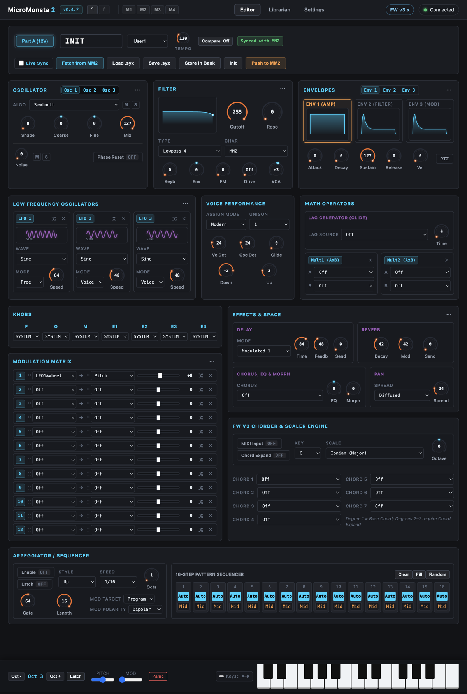

# MicroMonsta 2 Editor & Patch Librarian

A browser-based hardware editor, patch librarian, and duplicate manager for the [Audiothingies MicroMonsta 2](https://audiothingies.com/) synthesizer. It uses the Web MIDI API and SysEx, with no build step and no dependencies.

> This is an unofficial community project. It is not affiliated with or endorsed by Audiothingies.

## RUN IT LIVE!

[https://stickster.github.io/micromonsta2-editor]

This page runs on your system only. No data is shared or sent to me or GitHub. Feel free to bookmark and use it anytime, without using GitHub. Instructions below only matter if you want to tinker with the code yourself.

(The live editor here runs off the `main` branch only. Some features may not be released yet. To use them, you must get the code as shown below and `git switch devel` before loading in your browser.)

## Screenshots



## Features

- **Single-Screen Synthesis Rack**: View and edit all synthesis sections at once, without hunting through deep menus or modal tabs.
- **Interactive Visualizers**: Real-time response curves and waveform previews for the Filter, Envelopes, and LFOs update as you shape a sound.
- **Drag-and-Drop Modulation**: Drag LFOs, Envelopes, or Math Multipliers directly onto destination controls to wire up modulation slots
- **Drag-and-Drop Copy**: Drag Oscillators, LFOs, Envelopes, Math Multipliers, Mod Matrix (sources, destinations, or whole slots) to copy. Reorder Mod Matrix slots by dragging them around.
- **Fast Parameter Editing**: Click any knob value to type an exact number (or hold `Shift`/`Ctrl` for fine control).
- **Oscillator Listening**: Toggle oscillator Mute and Solo (including noise) to isolate and fine tune.
- **Hardware Sync and Bitimbral Workflow**: Automatic MicroMonsta 2 port detection and timbral mode tracking.
- **Patch Convenience:** `Part A ↔ Part B` copying built in. Two modes available:
   - Use **Fetch from MM2** / **Push to MM2** for quick transfers from/to current hardware state. Use the `Compare` toggle to hear differences quickly, OR:
   - Use **Live Sync** mode which streams changes directly to hardware over 7-bit/14-bit NRPN (great for testing modulations).
- **Full Multi-step Undo / Redo:** Uses`Cmd/Ctrl+Z`, `Cmd/Ctrl+Y` to make it easy to rewind or replay changes.
- **Built-In Keyboard and Chorder Preview**: Always-available bottom keyboard with QWERTY note input, octave controls, latch, pitch/mod wheels, MIDI Panic, and dual-color highlighting of Chorder chords.
- **Patch Librarian and Duplicate Manager**: Organize banks locally, search and filter by category, import/export `.syx` files, and detect or condense redundant duplicate patches.
- **Privacy Respecting and Zero Setup**: Runs **100% LOCALLY** in your browser with zero dependencies, no account, and no data leaving your machine. 
- **Multi-window coordination**: Supports multiple instances in case you want to see Parts A and B simultaneously. Extra browser windows don't collide over MIDI.

## Hardware Limitations (System & Combi Settings)

Due to the MicroMonsta 2 firmware implementation, certain settings cannot be read or managed remotely over USB-MIDI or TRS/DIN:

- **Combination Settings:** Combination definitions (such as Stack vs. Split mode, split point note, layer mix/balance, transpose, and performance controller assignments) cannot be read, edited, or backed up over MIDI. While MIDI Program Change (0–99) selects stored combination presets on the hardware, configuring combination parameters must be done directly using the MM2's screen and encoders.
- **System Settings:** Global hardware options (master tuning, MIDI base channel, screen timeout, button-hold times) are not accessible via SysEx or NRPN.
- **SysEx Scope:** Official MM2 SysEx dumps are strictly 216-byte single-layer sound presets (Layer A or Layer B). They do not include system configurations, combi presets, custom wavetables, or microtuning tables.
- **Timbral Mode Selection:** The editor automatically detects whether the unit is monotimbral or multi-layer by probing Layer B, but switching between Monotimbral, Bitimbral, and Combi modes must be done on the synth hardware itself.

## Requirements

- A MicroMonsta 2 (firmware v3.x) connected over USB or MIDI.
- A Chromium-based browser (Chrome, Edge, Opera) with Web MIDI support. Firefox and Safari are not yet supported.

## Getting Started

No install is needed.

1. Clone the repo:
   ```sh
   git clone <repo-url>
   cd micromonsta2-editor
   ```
2. Open `index.html` in a Chromium-based browser.
3. Allow MIDI/SysEx access when the browser asks.
4. Select your MicroMonsta 2 ports in **Settings**.

> [!WARNING]
> **Caveat emptor.** The authors are not responsible for the integrity of your hardware or patches. _Live Sync_ mode sends data to your synth immediately, and it is possible to overwrite your favorite sounds when you push patches from the Editor or Librarian, so you must back up the patches you care about first.

## Project Structure

```
index.html            App shell and UI markup
css/style.css         Styles
js/
  mm2-specs.js        Parameter definitions and MM2 program model
  sysex-parser.js     SysEx parsing and building
  patch-librarian.js  Patch storage, search, and duplicates
  midi-manager.js     Web MIDI I/O
  ui-controls.js      Reusable UI controls (knobs, etc.)
  app.js              Main application controller
tests/                Automated test suite
```

Scripts are loaded as plain globals in the order listed in `index.html`. There are no modules or bundler.

## Testing

Run the suite from the command line (Node.js required):

```sh
node tests/cli-runner.js
```

Or open `tests/index.html` in a browser.

## Contributing

Contributions are welcome.

1. Fork the repo and create a branch.
2. Enable the repo's git hooks:
   ```sh
   git config core.hooksPath .githooks
   ```
   - `pre-commit` runs the test suite, and the commit is aborted if it fails.
   - `commit-msg` enforces [Conventional Commits](https://www.conventionalcommits.org/).
3. Write commit messages as `<type>(<optional-scope>): <summary>`. Allowed types are `feat`, `fix`, `refactor`, `style`, `test`, `docs`, `chore`, `perf`, `ci`, and `build`. Example: `feat(ui): add compact voice panel`.
4. Add or update tests in `tests/test-suite.js` for behavior changes.
5. Keep the stack simple: vanilla JS, HTML, and CSS, with no frameworks or build tooling.
6. Open a pull request against `devel` branch, describing the change.

## License

[MIT](LICENSE)

